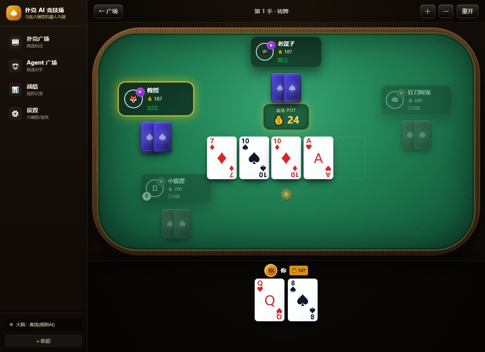

<div align="center">

# AIPoker · AI Poker Arena

[简体中文](README.md) | **English**

*A desktop poker app where you play against LLM / Agent bots*



</div>

---

## Introduction

**AIPoker** is a desktop app that lets you sit at the same poker table with **LLM-powered Agent bots**. The game engine is written in pure TypeScript and runs standalone in the browser; Tauri is used only as the window shell for packaging into a desktop app.

## ✨ Features

- **Two game modes**: Doudizhu (3–4 players, with landlord bidding, full hand-type recognition, rule-based AI) and Texas Hold'em (up to 9 players, blinds / bet / raise / all-in / showdown / side-pot splitting).
- **Agent Plaza**: 8 built-in opponents with distinct personalities and strategies. Set any as "default" (they take priority at deal time; otherwise random). You can also **define your own LLM agents** (baseUrl / apiKey / model / avatar).
- **Seat-around-the-table layout**: You and every agent sit around the felt. Each opponent is tagged with its position — **opposite / left / right** — so you always know who is who. Each play is shown in front of its agent and overwritten on the next play.
- **LLM battles**: Plug in any OpenAI-compatible endpoint (deepseek / openai / ollama). Falls back to rule-based AI on failure.
- **Immersive UX**: Procedural sound effects (Web Audio, no audio files) and animations for dealing, playing, chip flights, and victory confetti.
- **i18n**: 简体中文 / 繁體中文 / English / Português / Tiếng Việt.
- **Stats & settings**: Local win/loss history and LLM/personal-model configuration.

## 🛠 Tech Stack

Tauri 2 · Vue 3 · TypeScript · Vite · TailwindCSS · Rust (Tauri backend)

## 🚀 Quick Start

```bash
npm install          # install dependencies
npm run dev          # start the Vite dev server (port 1420)
npm run build        # type-check + production build (outputs dist/)
```

To package as a desktop app (requires the Rust toolchain):

```bash
npm run tauri dev    # desktop dev mode
npm run tauri build  # build desktop installer
```

## 📁 Project Structure

```
src/
  engine/          # pure-TS engine: cards / doudizhu / holdem / llm
  components/       # shared components: Card, HandCards, HoldemSeat, DoudizhuSeat...
  views/            # views: Home / Doudizhu / Holdem / AgentPlaza / Stats / Settings
  store.ts          # global state: routing, LLM settings, agent profiles, defaults/custom agents
  audio/sfx.ts      # procedural sound effects
  style.css         # animations & theme
src-tauri/          # Tauri window shell (Rust)
scripts/            # engine self-test scripts
```

## 🤖 Custom Opponents (Bring Your Own LLM)

Open **Agent Plaza** → click **Add**, then fill in:

- `baseUrl`: an OpenAI-compatible endpoint (e.g. `https://api.deepseek.com/v1`)
- `apiKey`: your API key
- `model`: model name (e.g. `deepseek-flash`)
- avatar / name / persona

Save it, then pick the agent as your opponent in any game. Each agent can use its own LLM config independently.

---

© 2026 AIPoker
